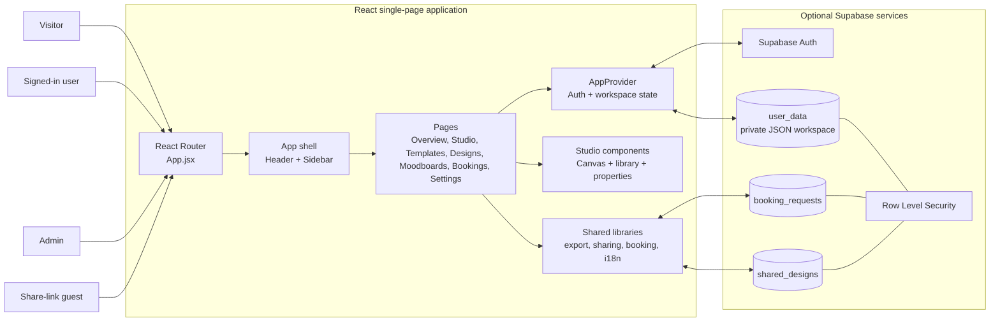
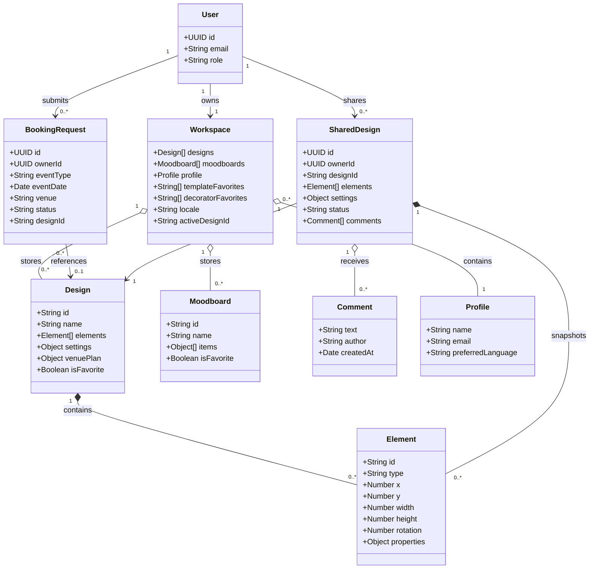
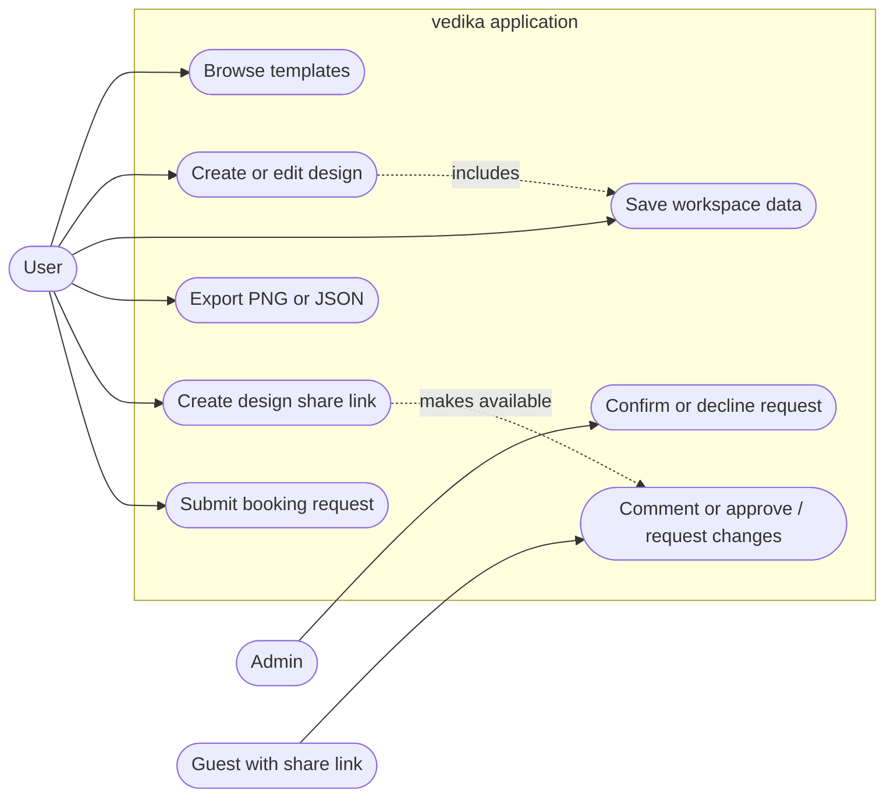
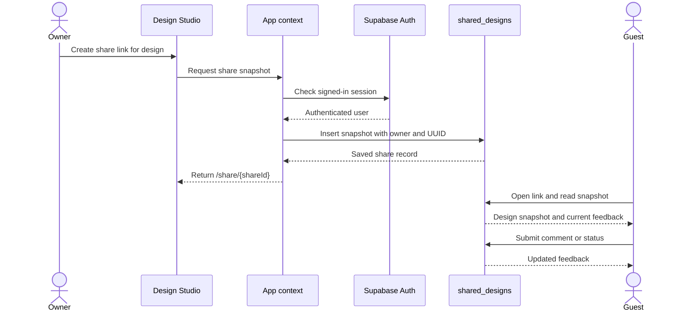
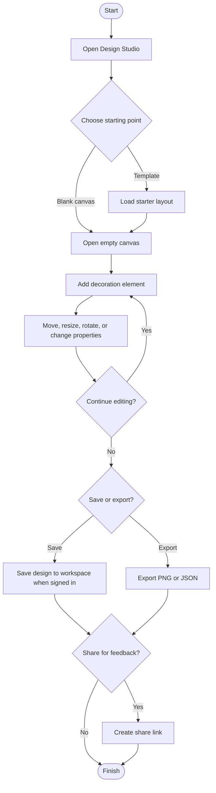
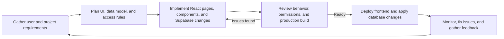
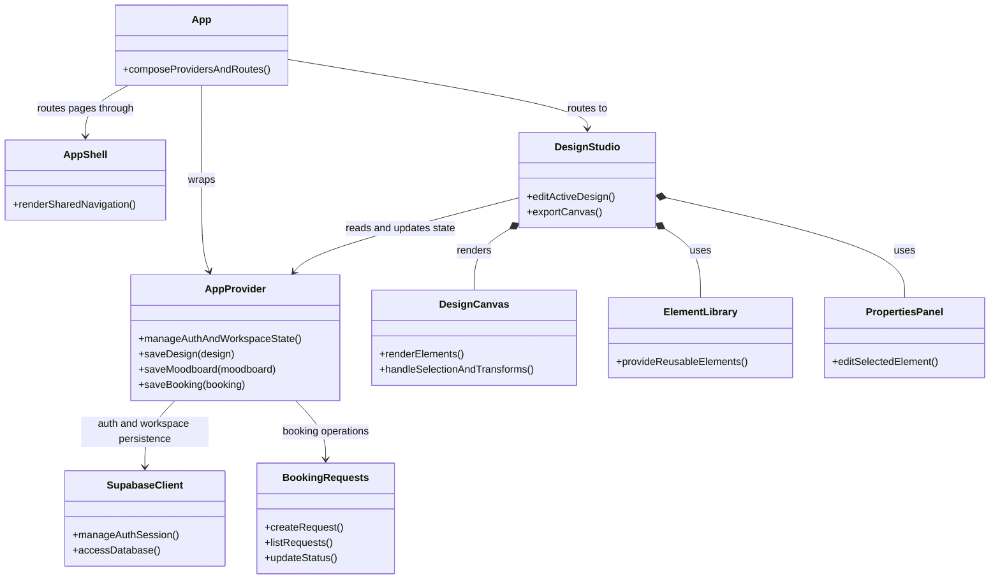

# Vedika system diagrams

These diagrams describe the current Vedika repository. They are written in Mermaid, so they render in GitHub and in Markdown tools that support Mermaid.

## Structural diagram: application architecture

Supabase is optional configuration. Workspace records, booking requests, and share snapshots use separate database tables; authentication is handled by Supabase Auth.

## Structural diagram: domain class model

This is a conceptual UML class view of the application's data, rather than a claim that JavaScript classes are instantiated for these records. In the implementation, workspace data is held in React state and serialized to JSON.

## Behavioral diagram: use cases

## Behavioral diagram: share and feedback sequence

## Behavioral diagram: design editing activity

## Development lifecycle diagram

The repository does not encode a formal SDLC process. This diagram is a practical lifecycle for maintaining and extending the current project; the implementation and review stages should be repeated as features change.

## Development class diagram

The following class-style view maps the major source modules and their dependencies. The project uses React function components and hooks, so the boxes represent modules/components rather than object-oriented classes.

